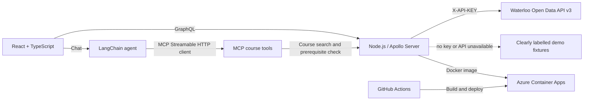

# Campus AI — Waterloo course planning assistant

A full-stack academic-planning prototype based on the Campus AI Week 11 Figma study. It turns the research insight — *students need to trust where AI advice comes from* — into a working course lookup and prerequisite-checking experience.

> **Important:** Until a Waterloo Open Data API key is configured, the app runs on a small, explicitly labelled demo fixture. Demo prerequisite checks are always returned as **unverified**. The fixture is not an official catalog and must not be used to make enrollment decisions.

## What works

- React + TypeScript dashboard, semester planner, course search, degree-progress sample, and chat UI.
- Apollo Server / GraphQL queries for active-term course details and prerequisite checks.
- An MCP server with `search_courses`, `get_course`, and `check_prerequisites` tools.
- A LangChain agent that connects to those tools through an MCP Streamable HTTP client when `OPENAI_API_KEY` is configured.
- A no-model-key demo path that still calls the MCP tools and checks the prerequisite rule deterministically.
- Source links, data-mode indicators, health endpoint, tests, a 32-case synthetic rule regression set, Docker, Azure Container Apps Bicep, and GitHub Actions workflows.

## Architecture



### Request flow

1. Chat submits the question and the student's self-reported completed-course list.
2. When configured, the LangChain agent decides which course-planning MCP tools to call.
3. The MCP server reads the Waterloo course catalog through the shared course service.
4. Prerequisite groups are checked with deterministic code; the model is not asked to decide eligibility.
5. The UI shows the course record's source link, the exact requirement text, and whether the data is live or demo.

## Local setup

**Requirements:** Node.js 22+ and npm. (The project was bootstrapped and verified with Node.js 26.)

1. Install dependencies: `npm install`
2. If npm 11 reports blocked `esbuild` / Apollo protobuf postinstall scripts, review and allow those build scripts with `npm install-scripts approve @apollo/protobufjs esbuild`.
3. Copy `.env.example` to `.env` and add keys if available.
4. Start both the API and Vite: `npm run dev`
5. Open `http://localhost:5173`.

Useful endpoints:

- GraphQL / Apollo Sandbox: `http://localhost:4000/graphql`
- MCP Streamable HTTP: `http://localhost:4000/mcp`
- Health: `http://localhost:4000/api/health`
- Local stdio MCP server: `npm run mcp`

### Live Waterloo course data

1. Read the University of Waterloo Open Data API v3 [getting-started guide](https://uwaterloo.atlassian.net/wiki/spaces/UWAPI/pages/34025641600/Getting+Started+-+OpenAPI).
2. Register a project and email address for a key, then confirm the email. Send the key as `X-API-KEY`; keep it server-side in `WATERLOO_API_KEY` and out of source control.
3. Check the [live API documentation](https://openapi.data.uwaterloo.ca/api-docs/index.html), announcements, request limits, and current terms before relying on the API. The API documents a per-key rate limit and can return HTTP 429.

The Courses endpoint includes `requirementsDescription`; prerequisite text is displayed verbatim and parsed conservatively. Special requirements, minimum grades, co-requisites, exclusions, and program-specific rules may not fit a simple course-code expression. The app does not claim to make an official enrollment determination.

### Optional LangChain model

Set `OPENAI_API_KEY` and optionally `LANGCHAIN_MODEL` (defaults to `openai:gpt-4.1-mini`). Without a model key, chat uses the built-in deterministic demo flow and still makes MCP tool calls. The app never inserts a fake model answer or a fictitious benchmark.

## Verification

```text
npm run typecheck
npm test
npm run eval
npm run build
```

The evaluation suite contains **32 synthetic prompts** over the demo fixture. `npm run eval` writes `evaluation/latest-report.json` with the rule-regression accuracy and median in-process rule evaluation time. These numbers measure only the deterministic prerequisite parser/checker on synthetic fixture data. They are **not** real student-query accuracy, live Waterloo catalog accuracy, LangChain answer quality, or end-to-end API latency. Run a separately reviewed 30–50-question gold set against live catalog responses and the chosen model before putting evaluation numbers on a résumé.

## Docker

Build and run locally with Docker Desktop:

```text
docker build -t campus-ai .
docker run --rm -p 4000:4000 --env-file .env campus-ai
```

The app listens on port 4000. Do not commit `.env` or bake any API key into an image.

## Azure Container Apps

The Bicep starter is in `infra/main.bicep`. It provisions a Basic Azure Container Registry, Log Analytics workspace, Container Apps environment, one externally reachable app with HTTPS ingress, health probes, and a system-assigned identity with `AcrPull` on the registry. Start with a resource group in your Azure for Students subscription and review regional availability, quotas, and current costs before deployment.

Provision with the Azure CLI after selecting your subscription and resource group. Pass `waterlooApiKey` / `openAiApiKey` as secure parameters from a local, untracked parameter file or a secret store; never place secret values in a committed `.bicepparam` file. The app can run without either key, but then it uses labelled fixtures and no hosted LLM.

### GitHub Actions deployment

`.github/workflows/ci.yml` runs typecheck, tests, the synthetic evaluation, and production build. `.github/workflows/deploy-azure.yml` builds and deploys the image on pushes to `main` after you provision Azure resources. Configure repository secrets:

- `AZURE_CREDENTIALS` — service-principal JSON accepted by `azure/login`.
- `AZURE_ACR_NAME` — registry resource name, without `.azurecr.io`.
- `AZURE_CONTAINER_APP_NAME` — deployed Container App name.
- `AZURE_RESOURCE_GROUP` — resource group containing the app and registry.

The service principal requires permission to push to the registry and update the Container App. Use a narrowly scoped identity; review the Azure deployment action and credential method for your organization before enabling automatic production deployment.

## Data use and attribution

Waterloo's Open Data API says its datasets are authoritative, approved, and timely, and requires an API key for v3 requests. The University copyright page allows **non-commercial URL references** when each reference acknowledges that the information resides at and is the property of the University of Waterloo; requests to use the information in other ways should be directed to the dataset maintainer / University. This demo therefore displays source attribution and links and does not bundle a bulk official data dump. Review the latest API-specific terms and obtain any needed permission before redistributing or using University data commercially.

## Deployment and sharing checklist

- [ ] Confirm current Waterloo API terms and API key request limits.
- [ ] Configure and test a live API key; inspect actual prerequisite text and citations.
- [ ] Run the gold-set evaluation and report measured live accuracy and latency, not fixture numbers.
- [ ] Provision Azure resources and configure GitHub Actions secrets.
- [ ] Push this project to the GitHub repository you choose, then enable Actions and publish the deployed URL.

## Résumé bullet — fill in only after measuring

**Course Planning AI Agent | TypeScript, LangChain, MCP, GraphQL, Azure | GitHub | Demo**

- Built a LangChain agent that calls MCP course tools over a Node.js/Apollo GraphQL API for Waterloo Open Data, showing source links with prerequisite guidance.
- Deployed with Docker to Azure Container Apps via GitHub Actions; evaluated on **[N real, reviewed questions]**, reaching **[X% measured accuracy]** at **[Y s median end-to-end latency]**.
